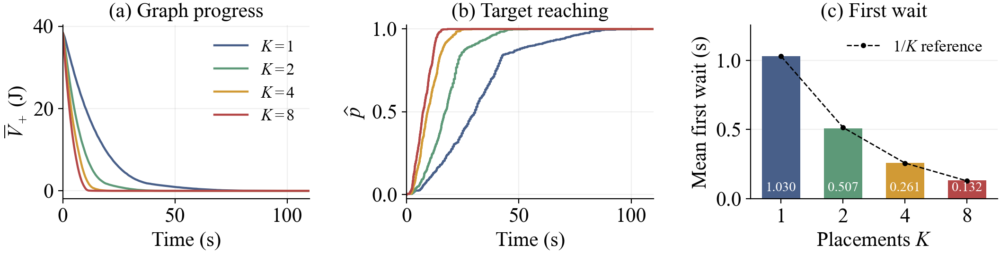
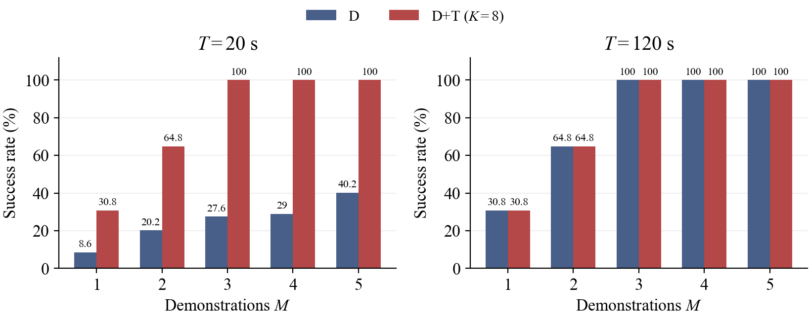
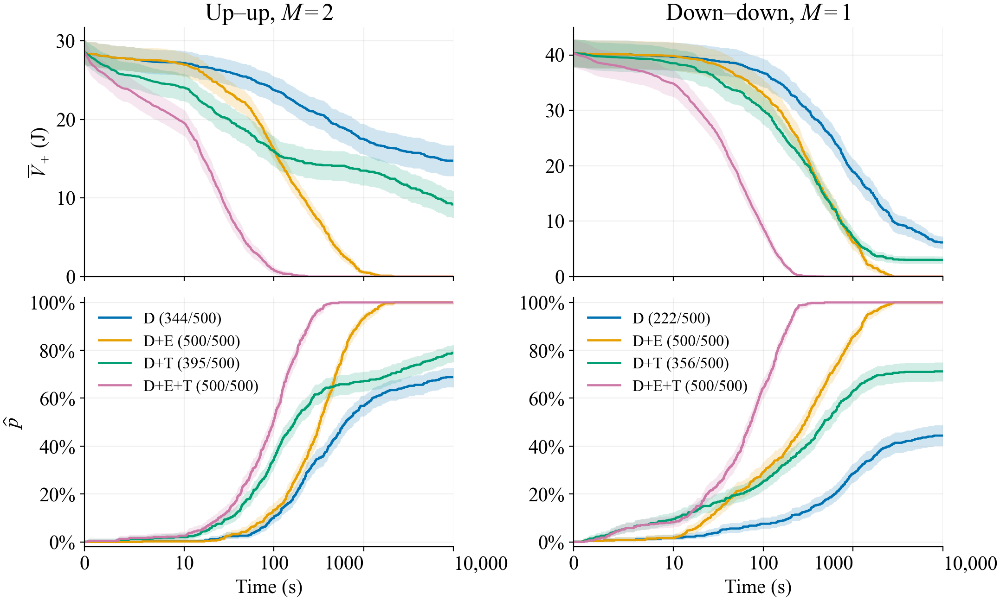
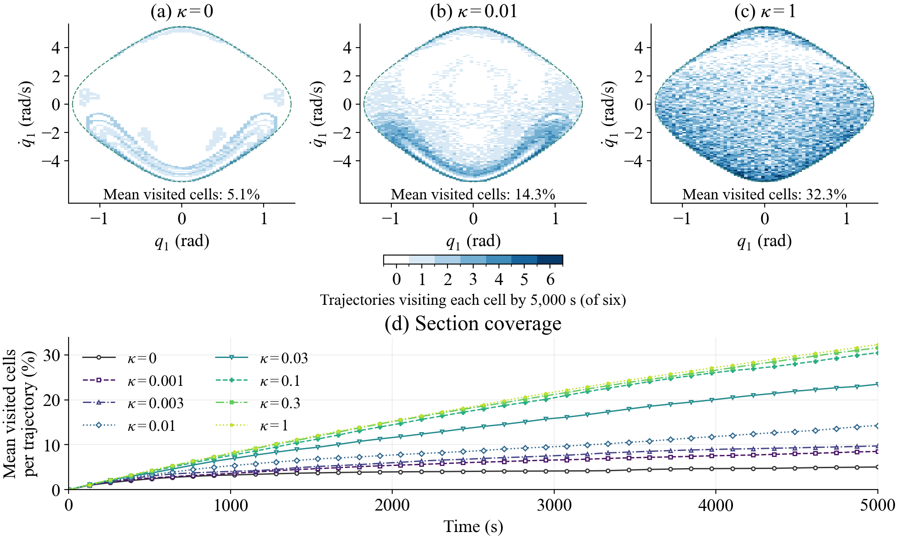

# Journal extension: chain policies with exploration and transport

Code, demonstration data, control primitive libraries and results for the numerical section of

> *Neuro-Inspired Control Through Motor Primitive and Natural Motion Composition in Hamiltonian Systems*
> (manuscript in preparation),

the journal extension of the conference paper described in the [repository root](../README.md).
Everything outside this folder belongs to the conference paper and is unchanged.

The extension measures progress by an energy-based distance on the Reeb graph of the Hamiltonian and
adds two mechanisms to the chain policy:

* **Exploration** uses energy-preserving inputs to bring the state to a stored primitive when passive
  motion alone does not.
* **Transport** certifies a stored primitive at further states along the passive flow, which shortens
  the waits between primitives.

Four policies are compared: the demonstration-based chain policy (D), D with transport (D+T), D with
exploration (D+E), and D with both (D+E+T).

## Results

**Single pendulum** (500 initial states, three demonstrations).  Transport does not change which
initial states reach the target; it changes how soon they do.

| Placements per anchor, K | 1 (D) | 2 | 4 | 8 |
| --- | --- | --- | --- | --- |
| Mean reaching time (s) | 31.53 | 17.73 | 10.07 | 7.64 |
| Time by which every trial has reached the target (s) | 102.5 | 53.7 | 28.6 | 18.1 |

At 20 s, D+T with K = 8 has already reached every state that either policy reaches by 120 s.

**Double pendulum** (500 initial states per target, horizon 10,000 s).  Passive motion fails to reach
a stored primitive from many initial states; exploration restores access, and transport then shortens
the waiting.

| Successes out of 500 | D | D+E | D+T | D+E+T |
| --- | --- | --- | --- | --- |
| Up-up target | 344 | 500 | 395 | 500 |
| Down-down target | 222 | 500 | 356 | 500 |

Exploration alone raises the coverage of a Poincaré section at 15 J from 5.1% under passive motion to
32.3% at the largest gain after 5,000 s.

## Contents

| Path | What it holds |
| --- | --- |
| `meeting_single_nmpc_effort_v3/` | Single pendulum: five NMPC demonstrations, the 64,563 original assignments, the transported assignments for K = 2, 4, 8, and 500 trials per library |
| `meeting_double_nmpc_rk4/` | Double pendulum: three NMPC demonstrations, the libraries for 0, 2, 4 and 8 transport shifts, and 6,000 trials (two targets, six policies, 500 initial states) |
| `meeting_dynamics_kappa_half_decade/` | Exploration alone on the double pendulum: section coverage for eight gains |
| `figures/` | The four result figures as they appear in the paper |
| `paper_figures.py`, `figure_style.py`, `sync_figures.sh` | Redraw the figures from the stored runs |
| `verify_nmpc_text.py` | Recomputes every number quoted in the numerical section and its supplement |
| `reference_single/`, `event_detection/` | Single-pendulum model, target, exact passive flow and event detection |
| `reference_code_7974f19e/` | Copy of this repository's `symplectic_ncp` package at commit `7974f19e`, imported by the single-pendulum scripts |
| `meeting_double_10000/`, `meeting_dynamics_kappa10_1000/` | The few files of two earlier studies that the scripts above read |

The folder names are the working names of the studies.  The README inside each study folder is its
lab note; it also refers to earlier versions of the study, which are not part of this release.

## Reproducing

Python 3.12 with the packages of `requirements.txt`:

    pip install -r requirements.txt

Redraw the figures and list the quoted numbers.  Both read the stored runs and recompute nothing else:

    ./sync_figures.sh              # writes figures/*.pdf and *.png
    python verify_nmpc_text.py     # 62 statements

Recompute a study from scratch:

    cd meeting_single_nmpc_effort_v3 && ./run_all.sh                          # about 25 min on 16 cores
    cd meeting_double_nmpc_rk4 && python demonstrations.py && ./run_all.sh    # about 45 min on 16 cores
    cd meeting_dynamics_kappa_half_decade && python run.py --workers 8 && python summarize.py   # about one minute

## Notes

* **Stored trials and the code fingerprint.**  Each file in `meeting_double_nmpc_rk4/results/` records
  a fingerprint of the code and inputs that produced it.  `benchmark.py` differs from that code in one
  docstring line (a machine-specific interpreter path was removed), so `run.py` refuses to reuse the
  stored trials.  Move `results/` aside before recomputing the double pendulum.
* **Frozen inputs.**  The single-pendulum scripts check the SHA-256 of their inputs against
  `protocol.json`.  File and folder names are therefore kept as they were.
* **Sensitivity.**  Long double-pendulum trials without exploration are sensitive to the integration
  step: halving it on twelve states per target changes 10 of 96 success labels.  Recomputed trials can
  therefore differ from the stored ones on another machine or library version.  The stored files are
  the ones the paper reports.
* **Certificates.**  The numerical checks are empirical; they are not validated enclosures over whole
  supports.
* **Fonts.**  The figures use Times New Roman when it is installed and a metric-compatible clone
  otherwise.
* **Size.**  About 440 MB, of which 330 MB are the per-trial files of the double pendulum.
